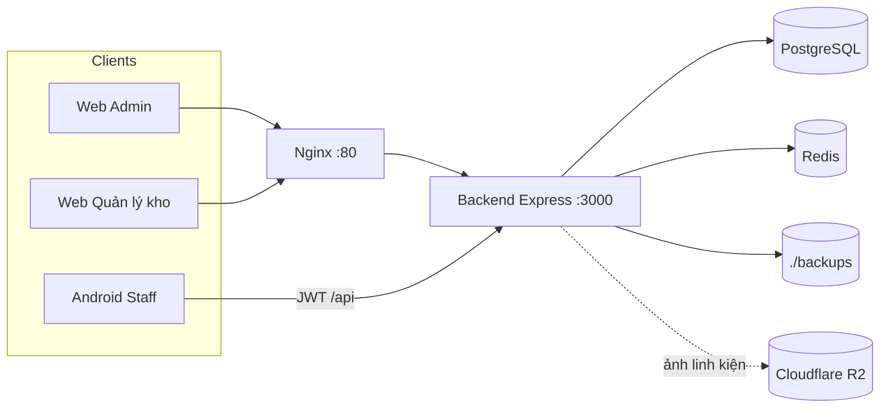
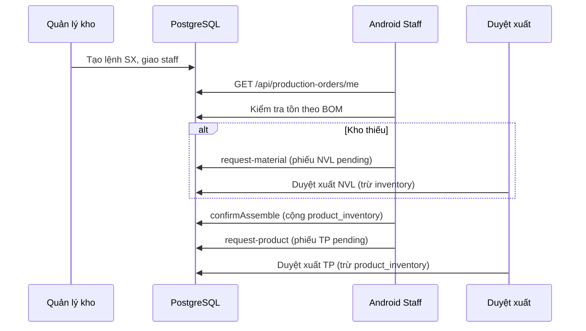

# Kiến trúc MRP PC Workshop

## 1. Tổng quan

Hệ thống gồm ba phần chính:

1. **Web panel** (Pug + Express session/cookie) — Admin và Quản lý kho  
2. **REST API** (`/api`) — App Android nhân viên lắp ráp  
3. **Hạ tầng** — PostgreSQL (dữ liệu), Redis (session web), Nginx (proxy), file backup `.sql`



## 2. Phân hệ theo vai trò

| Role | Prefix / kênh | Quyền mặc định (ý) |
|------|----------------|--------------------|
| `admin` | `/admin` | Tài khoản, phân quyền, sao lưu — **không** dashboard/vận hành kho |
| `warehouse_manager` | `/warehouse` | Dashboard + linh kiện + nhập/xuất + BOM + sản xuất |
| `staff` | Android `/api` | Không vào web (permissions rỗng); API chỉ `requireRole("staff")` |

Nguồn quyền mặc định: `backend/src/constants/permissions.ts`  
Cột Admin trên trang Phân quyền bị khóa; server luôn ghi `ADMIN_PERMISSIONS`.

## 3. Backend

### Stack

- Express 5 + TypeScript (`tsx` / Docker volume mount)
- Prisma ORM → PostgreSQL
- Session web: `express-session` + Redis
- API app: JWT (`Authorization: Bearer`)
- View web: Pug; static: `public/`

### Tổ chức mã

```
backend/src/
├── api/              # Route + controller REST cho Android
├── routes/           # Route web /admin, /warehouse
├── controllers/      # HTTP web
├── services/         # Nghiệp vụ (kho, phiếu, SX, backup, …)
├── middlewares/      # Auth, permission, role
├── constants/        # Permission keys, role defaults
├── config/           # system, database, redis
└── utils/
```

### Endpoint chính

| Nhóm | Đường dẫn | Ghi chú |
|------|-----------|---------|
| Health | `GET /health` | Kiểm tra sống |
| Web Admin | `/admin/*` | Cookie session |
| Web Kho | `/warehouse/*` | Cookie session |
| API App | `/api/auth/*`, `/api/production-orders/*` | JWT + role staff |

## 4. Luồng nghiệp vụ lắp ráp



### Tồn kho

- **Linh kiện**: bảng `inventory` (`quantity_on_hand`)
- **Thành phẩm**: bảng `product_inventory` (theo `pc_config_id`)
- Nhập kho confirmed → tăng `inventory`
- Duyệt xuất NVL → giảm `inventory`
- Confirm lắp → tăng `product_inventory` (và trừ NVL còn thiếu so với phiếu đã duyệt nếu BOM đổi)
- Duyệt xuất TP → giảm `product_inventory`
- Dashboard thành phẩm đọc `product_inventory` (cùng nguồn với duyệt xuất)

## 5. Sao lưu / khôi phục

- Service: `backend/src/services/backup.service.ts`
- Tạo: `pg_dump` → `mrp_pc-YYYY-MM-DD-HHMMSS.sql`
- Nạp: upload `.sql` (≤100MB) vào `BACKUP_DIR`
- Khôi phục: snapshot `safety-before-restore-*.sql` → `DROP SCHEMA public` → `psql -f`  
  Nếu nạp lỗi: cố phục hồi từ snapshot an toàn
- Quyền: xem/tải `backup_view`; tạo/nạp/khôi phục `backup_create`

## 6. App Android

- Kotlin + Jetpack Compose
- Retrofit + JWT interceptor
- Màn hình chính: Login → Danh sách lệnh (poll ~8s, banner lệnh mới) → Chi tiết → Kiểm tra tồn → Quy trình 3 bước
- Chỉ tài khoản `staff` active đăng nhập được API

## 7. Docker

| Service | Port host | Vai trò |
|---------|-----------|---------|
| `postgres` | 5432 | DB |
| `redis` | 6379 | Session web |
| `backend` | 3000 | App Node |
| `nginx` | 80 | Proxy tới backend |

Volume quan trọng: `pgdata`, `./backups:/backups`, `./backend:/app` (dev hot-reload).

## 8. Bảo vệ nghiệp vụ đáng chú ý (backend)

- Confirm phiếu nhập: chỉ một lần (`updateMany` khi `draft`)
- Tạo phiếu xuất từ app: khóa lệnh (`FOR UPDATE`) chống tạo trùng
- Duyệt xuất: transaction + chặn tồn âm
- Confirm lắp: không trừ trùng NVL đã xuất; trừ phần BOM còn thiếu
- Admin không bị đổi quyền qua PATCH phân quyền
